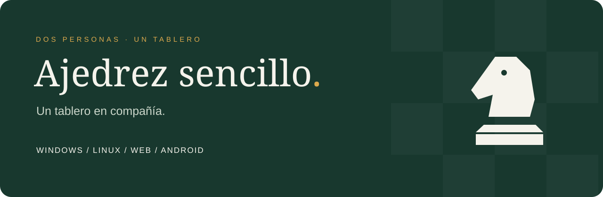
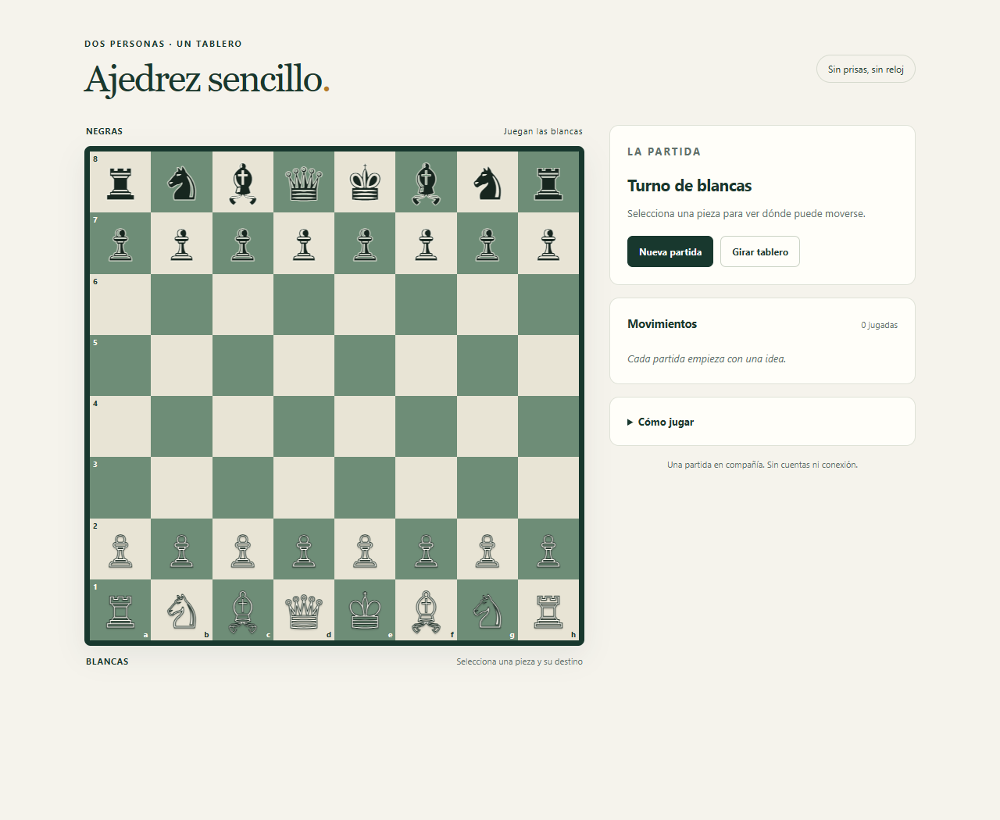
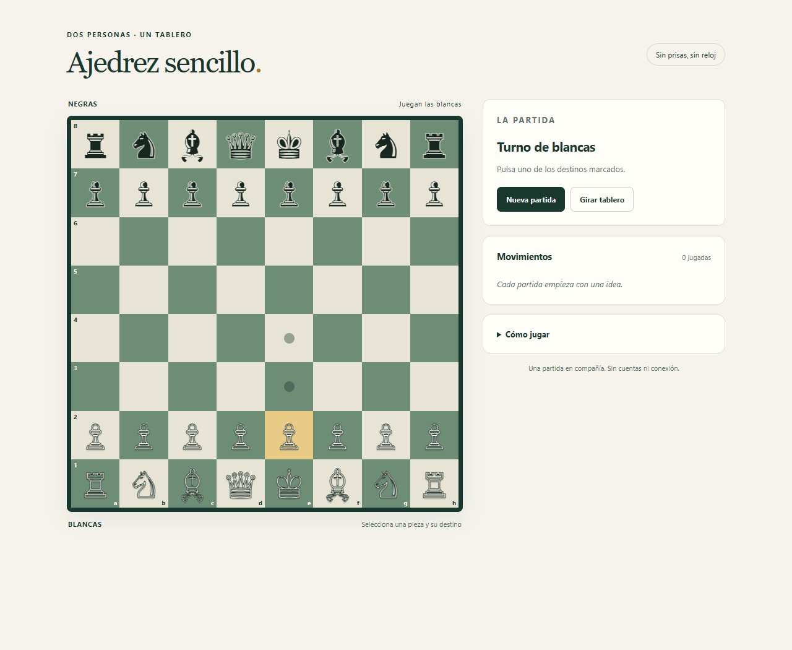
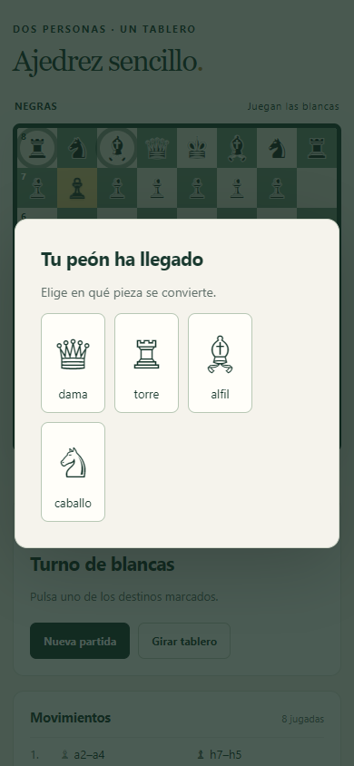

<p align="center"></p>

<p align="center">
<a href="LICENSE"></a>
<a href="https://github.com/Peskysa/ajedrez-sencillo/actions/workflows/verify.yml"></a>
<a href="https://github.com/Peskysa/ajedrez-sencillo/releases/latest"></a>
</p>

<p align="center"><strong>Dos personas. Un dispositivo. Toda una partida.</strong><br>Ajedrez en español, sin cuentas, sin anuncios y sin conexión durante el juego.</p>

<p align="center"><a href="https://peskysa.github.io/ajedrez-sencillo/"><strong>♞ JUGAR EN LA WEB</strong></a> · <a href="https://github.com/Peskysa/ajedrez-sencillo/releases/latest">Descargas</a> · <a href="docs/README.md">Documentación</a> · <a href="https://github.com/Peskysa/ajedrez-sencillo/issues/new/choose">Ayuda y sugerencias</a></p>

---

## Un tablero que invita a jugar

Selecciona una pieza y elige uno de sus destinos legales. El tablero se adapta a la pantalla, se puede girar y muestra el historial. El motor se encarga del jaque, las capturas, el enroque y la coronación.



## Elige dónde jugar

| Plataforma | Formato | Para empezar |
| --- | --- | --- |
| **Web** | Navegador y aplicación instalable (PWA) | [Abrir el tablero](https://peskysa.github.io/ajedrez-sencillo/) |
| **Windows** | Instalador EXE, x64 | [Descargas para Windows](https://github.com/Peskysa/ajedrez-sencillo/releases/latest) |
| **Linux** | AppImage y DEB, x64 | [Descargas para Linux](https://github.com/Peskysa/ajedrez-sencillo/releases/latest) |
| **Android** | APK preliminar, Android 8 o posterior; también PWA | [Descargas para Android](https://github.com/Peskysa/ajedrez-sencillo/releases/latest) |
| **Cualquier ordenador** | ZIP web portátil | Descomprime el ZIP web y abre `index.html` |

La web se instala desde el menú del navegador y queda disponible sin conexión tras la primera carga. Los paquetes nativos incluyen el juego completo. **No necesitas Node.js para jugar.**

Los instaladores de escritorio no tienen firma comercial. El APK usa firma de depuración y se ofrece como **preliminar**, no como distribución de Google Play; puede requerir desinstalar una versión previa para actualizar. [Requisitos e instalación](docs/INSTALACION.md).

## Pequeño por fuera, completo en lo esencial

| Para jugar | Para entender la partida |
| --- | --- |
| Movimientos legales y turnos alternos | Destinos y capturas destacados |
| Enroque corto y largo | Indicador de jaque y resultado |
| Captura al paso | Historial de movimientos |
| Cuatro opciones de coronación | Tablero giratorio |
| Jaque mate y tablas básicas | Teclado, ratón y pantalla táctil |

<table><tr><td width="70%"></td><td width="30%"></td></tr><tr><td align="center">Elige una pieza. El tablero te acompaña.</td><td align="center">También en pequeño.</td></tr></table>

Capturas de la aplicación web real. La vista móvil simula una pantalla de 390 píxeles; no es una captura de un dispositivo Android físico.

## Empieza una partida

1. Abre el juego. Empiezan las blancas.
2. Pulsa una pieza: los puntos muestran movimientos legales y los círculos, capturas.
3. Pulsa el destino. Para enrocar, mueve el rey dos casillas; al coronar, elige tu pieza.

**Girar tablero** cambia la orientación. **Nueva partida** pide confirmación después de la primera jugada. También puedes recorrer casillas con Tab y seleccionarlas con Enter.

## Documentación

- [Instalación y requisitos](docs/INSTALACION.md): Windows, Linux, Android, web y uso sin conexión.
- [Manual y reglas](docs/MANUAL.md): controles, finales y simplificaciones.
- [Desarrollo y compilación](docs/DESARROLLO.md): arquitectura, pruebas, capturas y paquetes.
- [Privacidad](docs/PRIVACIDAD.md): almacenamiento y conexiones.
- [Historial de versiones](CHANGELOG.md) y [notas de esta versión](docs/releases/v1.1.0.md).
- [Contribuir](CONTRIBUTING.md), [seguridad](SECURITY.md) y [licencias de terceros](docs/TERCEROS.md).

## Para desarrollar

La web y el motor no dependen de bibliotecas externas. Las herramientas de desarrollo usan Node.js 24 y npm.

```sh
npm ci
npm run build:web
npm test
npm start
```

Abre `http://127.0.0.1:8766`. Capturas reproducibles:

```sh
npx playwright install chromium
npm run screenshots
```

Las pruebas incluyen perft inicial hasta profundidad 4 (**197 281** secuencias), Kiwipete hasta profundidad 3 (**97 862**) y un final con capturas al paso, reglas especiales y comprobaciones del paquete web.

## Alcance

Para dos personas en el mismo dispositivo. Sin IA, partidas en red, reloj ni guardado. Al cerrar o recargar se pierde la partida. Las tablas por triple repetición y 50 movimientos se aplican automáticamente; la detección de material insuficiente cubre casos básicos. [Detalle](docs/MANUAL.md).

## Licencia

Código e identidad visual originales bajo [MIT](LICENSE). Creado por **Marco Pescador**. Puedes usarlo, estudiarlo, modificarlo y compartirlo conservando la licencia. Los componentes de empaquetado mantienen sus propias licencias.
