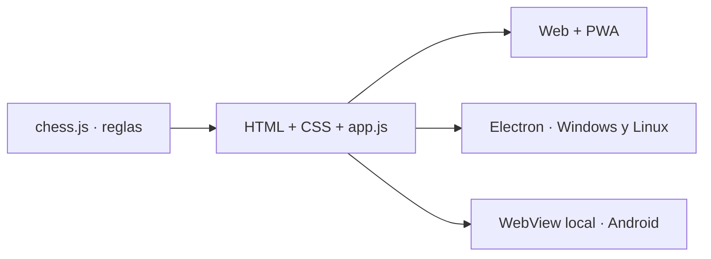

# Desarrollo

## Arquitectura



Un único motor y una misma interfaz. Los contenedores nativos empaquetan la web.

| Ruta | Responsabilidad |
| --- | --- |
| `chess.js` | Reglas independientes del navegador |
| `app.js`, `index.html`, `styles.css` | Interacción y diseño |
| `manifest.webmanifest`, `install.js`, `sw.js` | Instalación y caché |
| `desktop/`, `android/` | Contenedores nativos |
| `scripts/`, `tests/` | Compilación, capturas y pruebas |
| `assets/`, `docs/images/` | Identidad visual y capturas |
| `.github/workflows/` | Pruebas y publicación |

## Preparar

Node.js 24 y npm. Ejecuta `npm ci`, `npm run build:web`, `npm test` y `npm start`. El servidor local solo expone `dist/web`.

## Escritorio

```sh
npm ci
npm run build:desktop
```

Compila en Windows para NSIS, en Linux para AppImage/DEB. Resultados en `dist/desktop`. Sin firma comercial ni actualizador automático. Electron usa sandbox, aislamiento, protocolo local y no expone Node.js a la interfaz. [Guía oficial de seguridad](https://www.electronjs.org/docs/latest/tutorial/security).

## Android

JDK 17, SDK Android 36, Gradle 8.13 y AGP 8.13.2. [Compatibilidad oficial](https://developer.android.com/build/releases/agp-8-13-0-release-notes).

```sh
npm run build:web
cd android
gradle assembleDebug
```

La tarea previa copia la web. APK en `android/app/build/outputs/apk/debug/`. Variante preliminar; una publicación estable necesita un flujo de firma con clave privada persistente del propietario. No incluyas claves en Git.

## Capturas

```sh
npx playwright install chromium
npm run build:web
npm run screenshots
```

Captura escritorio, destinos y coronación móvil; verifica coronación y ajuste horizontal. `CHROME_PATH` permite usar un Chromium instalado.

## Publicar

`verify.yml` verifica el motor y el paquete, y despliega Pages desde main. `release.yml` compila Windows, Linux, APK preliminar y ZIP web al crear una etiqueta `v*`. Solo publica cuando terminan correctamente todos los trabajos y añade SHA-256.

Actualiza conjuntamente versión de npm, Android, caché y notas. La compilación automatizada no sustituye pruebas en dispositivos físicos.
